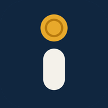
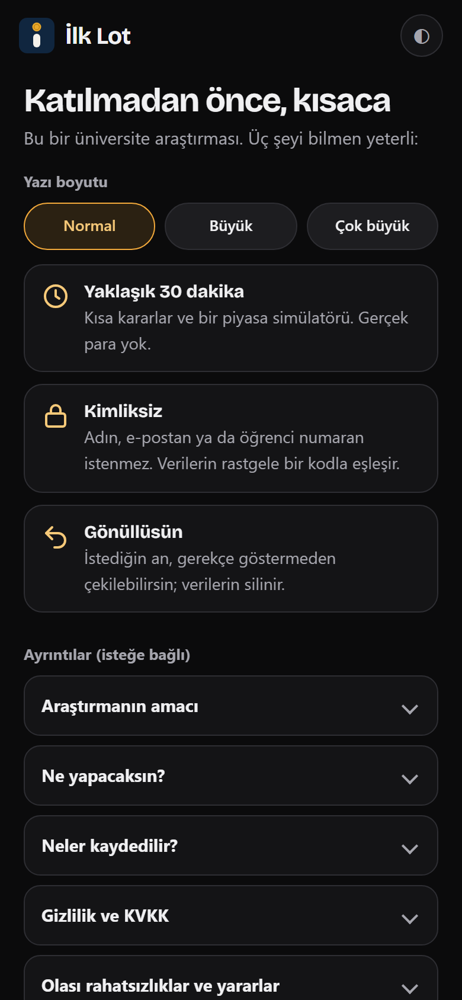
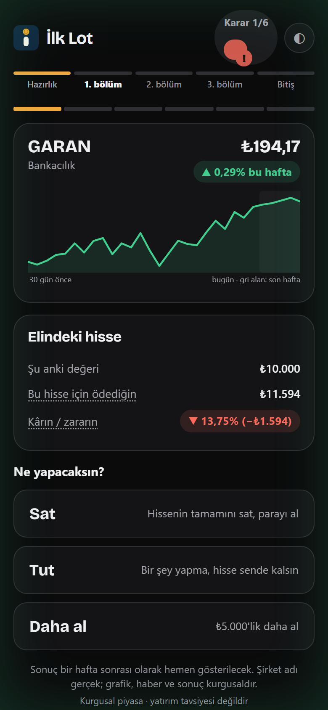
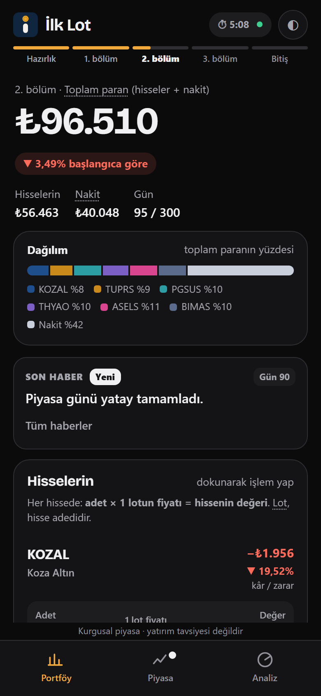
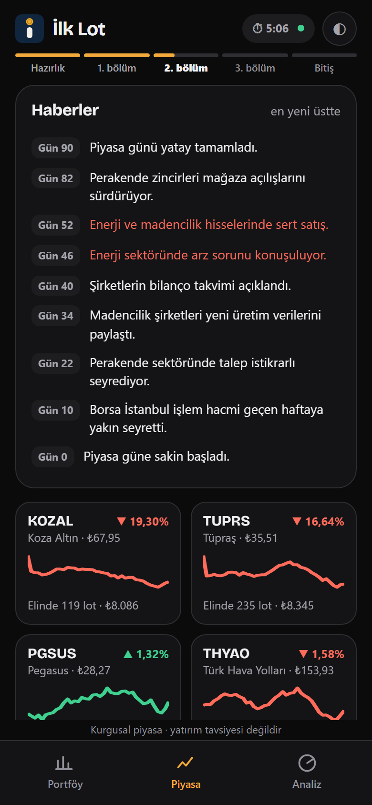
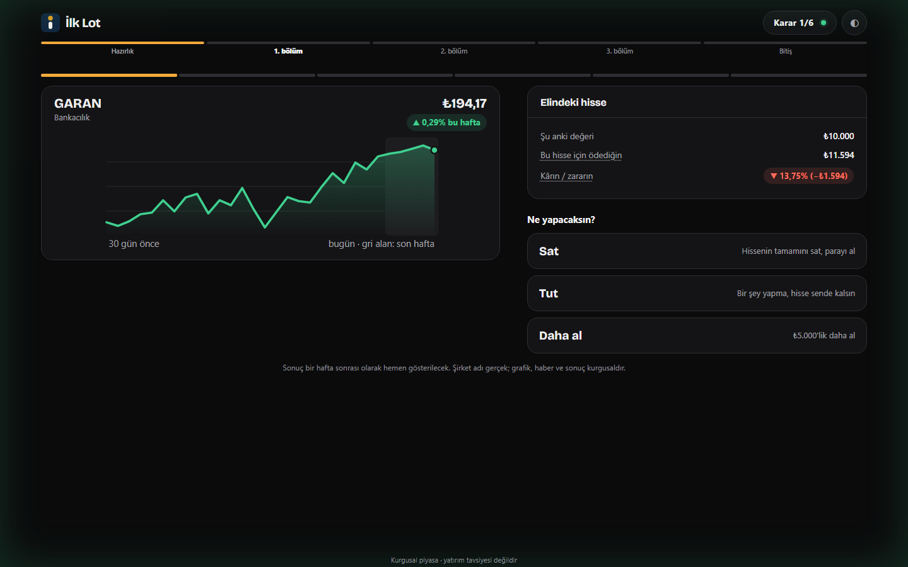
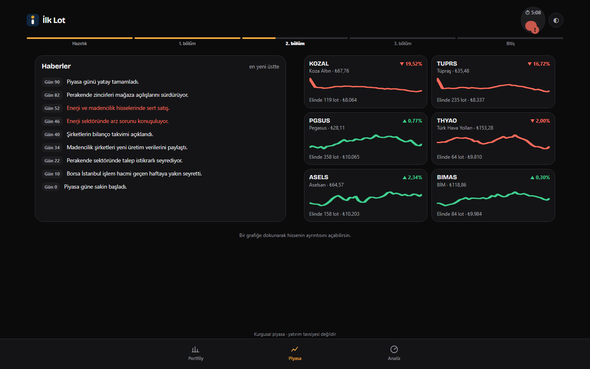
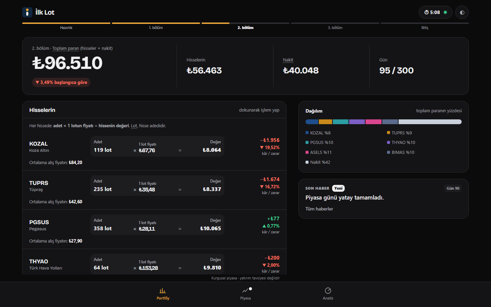
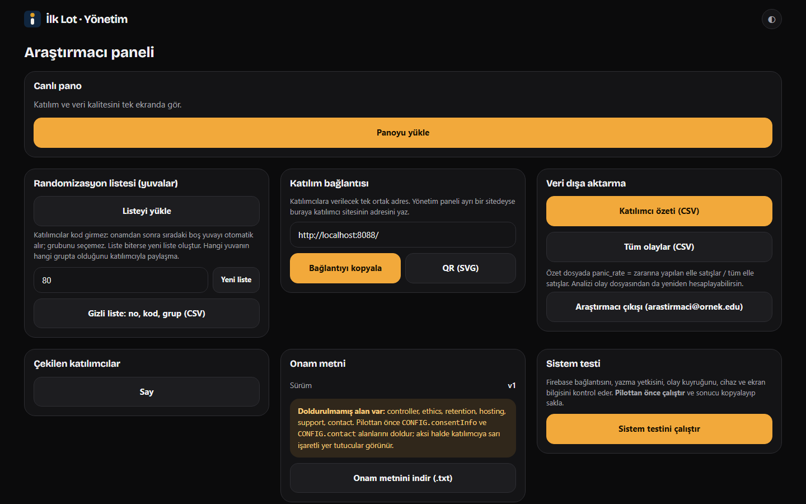

<div align="center">



# İlk Lot

**Genç yatırımcıların sert düşüş anındaki panik satışını inceleyen, telefonda çalışan bir davranış araştırması uygulaması.**

[](https://github.com/erengultekin028/ilk-lot/actions/workflows/test.yml)
[](https://github.com/erengultekin028/ilk-lot/actions/workflows/yayin.yml)


[**Canlı site**](https://ilk-lot-pilot.web.app) · [Yönetim paneli](https://ilk-lot-pilot.web.app/admin/) · [Mimari](docs/MIMARI.md) · [Kurulum rehberi](firebase/KURULUM.md) · [Devir notu](DEVIR_NOTU.md)

</div>

---

## Bağlantılar

| | Adres | Kim kullanır |
|---|---|---|
| **Katılımcı uygulaması** | https://ilk-lot-pilot.web.app | Katılımcılar (anonim giriş, kod gerekmez) |
| **Araştırmacı paneli** | https://ilk-lot-pilot.web.app/admin/ | Yalnızca araştırmacı (e-posta ve şifre) |
| **Kaynak kod** | https://github.com/erengultekin028/ilk-lot | Herkes |

> **Not:** Site şu an pilot öncesi aşamadadır. Katılımcı sayfası gerçek veritabanına bağlıdır; onamı kabul eden her ziyaretçi bir katılım yuvası tüketir. Davet edilmediysen onamı kabul etme.

## Ekran görüntüleri

Aşağıdaki ekranlar uygulamanın kendi kodundan, veritabanına bağlanmadan çizilmiştir. Piyasa, fiyatlar ve haberler **kurgusaldır**; gerçek para yoktur.

<table>
  <tr>
    <td align="center"><b>Onam</b></td>
    <td align="center"><b>Karar anı</b></td>
    <td align="center"><b>Simülatör: portföy</b></td>
    <td align="center"><b>Simülatör: piyasa</b></td>
  </tr>
  <tr>
    <td></td>
    <td></td>
    <td></td>
    <td></td>
  </tr>
</table>

**Geniş ekran:** uygulama pencerenin tamamını kaplar; karar ve simülatör ekranları iki sütuna geçer.

<table>
  <tr>
    <td align="center"><b>Karar anı</b></td>
    <td align="center"><b>Simülatör: piyasa</b></td>
  </tr>
  <tr>
    <td></td>
    <td></td>
  </tr>
  <tr>
    <td align="center"><b>Simülatör: portföy</b></td>
    <td align="center"><b>Araştırmacı paneli</b></td>
  </tr>
  <tr>
    <td></td>
    <td></td>
  </tr>
</table>

## Araştırma sorusu

> Genç yatırımcılar kayıptaki bir hisseyi sert düşüş sırasında panikle satıyor mu? Zararına satıştan önce konulan **10 saniyelik bir bekleme ekranı** bu davranışı azaltır mı, ve bekleme ekranı kalktıktan sonra etki sürer mi?

18 yaş üstü üniversite öğrencileri tek oturumda (yaklaşık 30 dakika) rastgele iki gruptan birine atanır. İki grupta da her şey aynıdır; tek fark, A grubunun simülatörde zararına satış öncesi bekleme ekranı görmesidir.

| Bölüm | İçerik | A grubu | B grubu |
|---|---|---|---|
| 1. bölüm | 6 karar anı (Sat / Tut / Daha al) | aynı | aynı |
| 2. bölüm | 7,5 dakikalık kurgusal piyasa simülatörü (300 gün, 6 hisse) | **10 sn bekleme ekranı** | bekleme yok |
| 3. bölüm | Farklı hisselerle 6 karar anı | aynı | aynı |

Ana ölçüt, "sert düşüş + zarar" anlarındaki satış oranının 1. bölümden 3. bölüme değişimi ve bunun iki grupta farklı olup olmadığıdır. Ayrıntı: [bir sayfalık özet](docs/OZET_1_SAYFA.md), [ön kayıt taslağı](docs/ON_KAYIT_TASLAGI.md), [veri sözlüğü](docs/VERI_SOZLUGU.md).

> Proje başvuru ve pilot öncesi aşamasındadır. **Henüz sonuç yoktur**; piyasa kurgusaldır ve çıkacak bulgular gerçek yatırım davranışına doğrudan genellenemez.

## Özellikler

- **Anonim katılım:** Katılımcı kod girmez. Onamdan sonra Firebase anonim girişiyle sıradaki **yuvayı** alır; grup, araştırmacının önceden ürettiği 4'lük bloklu listeden gelir. Katılımcı grubunu seçemez.
- **Ayrı araştırmacı paneli:** `/admin/` adresi e-posta ve şifre ister; yuva listesi, canlı pano, CSV dışa aktarma ve sistem testi içerir.
- **Gerçek zamanlı kayıt:** Kararlar ve olaylar Firestore'a yazılır; bağlantı koparsa kuyruklanır, sayfa yenilenince oturum kaldığı yerden sürer.
- **Kurgusal piyasa simülatörü:** Tohumlu, tekrarlanabilir fiyat yolu; haberler, sektörel krizler, portföy/piyasa/analiz sekmeleri, hisse ayrıntısı.
- **Duyarlı tasarım:** Telefon öncelikli; geniş ekranda tam pencere düzeni, açık ve koyu tema, üç yazı boyutu.
- **Silme yok:** Çekilen katılımcının kaydı işaretlenir (`withdrawn: true`), hiçbir yerde silinmez.
- **Yapı:** Paketleyici ve framework yok; tarayıcının yerel ES modülleri, MVVM katmanları.

## Mimari

```
public/                 Yayınlanan site (Firebase Hosting)
  index.html            Katılımcı uygulaması
  admin/index.html      Araştırmacı paneli (ayrı sayfa, ayrı giriş noktası)
  src/
    constants/          Sabitler ve içerikler
    models/             Saf iş mantığı (DOM yok): uyaran üretimi, simülatör motoru
    viewmodels/         Durum ve eylemler
    views/              Ekranlar (HTML dizesi üreten işlevler)
    widgets/            Yeniden kullanılan arayüz parçaları
    services/           Firebase, kimlik doğrulama, olay kaydı
    repositories/       Veri erişimi (katılımcı, yuva)
    admin/              Yönetim uygulaması
  styles/               CSS (tokens, bileşenler, ekranlar, geniş ekran, yönetim)
firebase/               Güvenlik kuralları, kural testleri, yayın aracı, kurulum rehberi
```

Katmanlar arasındaki kurallar, katılım akışı, veri sözleşmesi ve Firestore koleksiyonları için [`docs/MIMARI.md`](docs/MIMARI.md).

**Teknolojiler:** HTML, CSS, JavaScript (ES modülleri), Firebase Hosting, Firestore, Firebase Authentication (anonim + e-posta/şifre), GitHub Actions. Geliştirme: ESLint, Prettier. Analiz: Python (numpy, pandas, scipy).

## Hızlı başlangıç

Gereksinimler: Node.js 22+, Python 3.12+.

```bash
git clone https://github.com/erengultekin028/ilk-lot.git
cd ilk-lot
npm install
npm run serve
```

- Katılımcı uygulaması: http://localhost:8088/
- Araştırmacı paneli: http://localhost:8088/admin/

Dosyaya çift tıklayarak açılmaz; ES modülleri bir web sunucusu ister. Yerel sunucu da **gerçek Firebase projesine** bağlanır (yerel/örnek veri kipi yoktur). Deneme sırasında veri yazmamak için onamı kabul etme. Kendi Firebase projeni kullanmak için `public/src/constants/app-config.js` içindeki `CONFIG.firebase` değerini değiştir ve [`firebase/KURULUM.md`](firebase/KURULUM.md) adımlarını izle.

## Denetimler ve testler

```bash
npm run lint             # ESLint
npm run check:modules    # tüm modüller içe aktarılabiliyor mu
npm run check:classes    # JS'te kullanılan CSS sınıfları CSS'te tanımlı mı
npm run check:records    # test kaydı ayırma ve tam yedek mantığı
python testler/arac_testleri.py      # yayın aracı, takvim, CI tanımı, klasör yapısı, DOM kimlik denetimi
python testler/ekran_testleri.py     # tarayıcı uçtan uca testleri (Playwright; gerçek veri yazılmaz)
python analiz/test_betikler.py       # analiz betikleri
cd firebase/kural_testleri && npm install && npm test   # Firestore güvenlik kuralları (Node + Java)
```

GitHub Actions her gönderimde bunları çalıştırır (rozetler yukarıda). Tarayıcı testleri Firebase'i keser, gerçek veri yazılmaz; ayrıntı ve kapsam: [`testler/README.md`](testler/README.md). Eski (b26) tarayıcı testleri çalışmaz, yerlerini `ekran_testleri.py` aldı.

## Yayın

`main` dalına yapılan her gönderim, lint ve modül kontrolü geçerse siteyi **Firebase Hosting**'e otomatik yayınlar ([`.github/workflows/yayin.yml`](.github/workflows/yayin.yml)). Firestore güvenlik kuralları otomatik yayınlanmaz:

```bash
firebase deploy --only firestore:rules --project ilk-lot-pilot
```

Yayın öncesi ön kontrol (boş `[DOLDUR]` alanları, örnek e-posta, ölçüt kilidi): `python firebase/dagit.py`.

## Belgeler

| Belge | Konu |
|---|---|
| [`DEVIR_NOTU.md`](DEVIR_NOTU.md) | Proje durumu, kararlar, kurallar, doğrulanmayanlar |
| [`docs/MIMARI.md`](docs/MIMARI.md) | Katmanlar, katılım akışı, veri sözleşmesi |
| [`firebase/KURULUM.md`](firebase/KURULUM.md) | Firebase kurulumu, yayın, pilot yürütme, kontrol listesi |
| [`docs/VERI_SOZLUGU.md`](docs/VERI_SOZLUGU.md) | Firestore alanları, olaylar, CSV sütunları |
| [`docs/ON_KAYIT_TASLAGI.md`](docs/ON_KAYIT_TASLAGI.md) | Ön kayıt taslağı |
| [`docs/ERISILEBILIRLIK.md`](docs/ERISILEBILIRLIK.md) | Erişilebilirlik taraması (axe-core, WCAG 2.1 A/AA), sonuç ve bekleyen karar |
| [`docs/GERCEK_CIHAZ_TESTI.md`](docs/GERCEK_CIHAZ_TESTI.md) | Gerçek cihaz ve Firebase deneme protokolü (klavye ve ekran okuyucu dahil) |
| [`docs/PILOT_PLANI.md`](docs/PILOT_PLANI.md) | Pilot planı, karar kuralları ve rapor şablonu |
| [`docs/KONUM_VE_KVKK_KARARI.md`](docs/KONUM_VE_KVKK_KARARI.md) | Veri konumu ve KVKK seçenekleri, taşıma planı, KVKK birimine sorular |
| [`docs/KARAR_PAKETI.md`](docs/KARAR_PAKETI.md) | Pilottan önce kapatılacak kararlar (KVKK/konum, onam v2, ödül, lisans…) |
| [`docs/KURAMSAL_CERCEVE.md`](docs/KURAMSAL_CERCEVE.md) | Kuramsal çerçeve ve kaynakça taslağı (kaynaklar doğrulanacak) |
| [`docs/GANTT_VE_RISK.md`](docs/GANTT_VE_RISK.md) | İş-zaman çizelgesi (Gantt), kilometre taşları ve risk matrisi |
| [`docs/VERI_YONETIM_PLANI.md`](docs/VERI_YONETIM_PLANI.md) | Veri yaşam döngüsü, saklama, paylaşım, yedek |
| [`docs/ESKI_YENI_ADLAR.md`](docs/ESKI_YENI_ADLAR.md) | Eski ad → yeni ad tablosu |
| [`analiz/README.md`](analiz/README.md) | Analiz betikleri ve güç hesabı |
| [`etik/`](etik/) | Etik kurul başvuru taslağı, onam ve bilgilendirme metinleri |

## Etik ve veri

Katılım gönüllüdür; çekilme her an mümkündür. Ad, e-posta ya da öğrenci numarası toplanmaz; kayıtlar rastgele bir kodla eşleşir. Piyasa kurgusaldır, gerçek para yoktur ve hiçbir şey yatırım tavsiyesi değildir. Araştırmanın amacı oturum sonunda açıklanır. Onam metni ve etik başvuru taslakları [`etik/`](etik/) klasöründedir; onam metni etik kurul onayı olmadan değiştirilmez.

## Proje durumu

- [x] Anonim giriş ve sıralı yuva ataması
- [x] Ayrı araştırmacı paneli
- [x] Geniş ekran düzeni, Firebase Hosting, otomatik yayın
- [x] Güvenlik kuralları ve kural testleri (CI'da yeşil)
- [ ] Onam alanları (`[DOLDUR]`) ve iletişim adresi
- [ ] Gerçek cihazlarda deneme ve pilot
- [ ] Etik kurul onayı ve ön kayıt
- [x] Tarayıcı tabanlı uçtan uca testler yeni yapıya yazıldı (gerçek katılım akışı kapsam dışı: emulator ve gerçek cihaz testi)
- [x] Test kayıtlarını ayırma ve tam yedek (yönetim paneli)
- [ ] Kararların kapatılması: `docs/KARAR_PAKETI.md` (KVKK/konum, onam v2, lisans…)

## Lisans ve katkılar

**Tüm hakları saklıdır** (bilinçli karar, 28 Ekim 2026): bu depoya bir lisans eklenmedi; yani proje **açık kaynak değildir**. Kaynak kodu GitHub'da herkese açık olarak görüntülenebilir (GitHub kullanım şartları görüntüleme ve çatallamaya izin verir), ancak izin alınmadan kopyalanamaz, değiştirilemez ya da yeniden dağıtılamaz. Kullanım, atıf ve işbirliği için iletişime geç. Üçüncü taraf bileşenler kendi lisanslarıyla gelir: QR kitaplığı (Kazuhiko Arase, MIT), Bricolage Grotesque yazı tipi (SIL OFL 1.1).

Hata ve öneriler için [Issues](https://github.com/erengultekin028/ilk-lot/issues) kullanılabilir. Kodu değiştirmeden önce [`docs/MIMARI.md`](docs/MIMARI.md) içindeki veri sözleşmesine ve değişiklik kurallarına bak.
