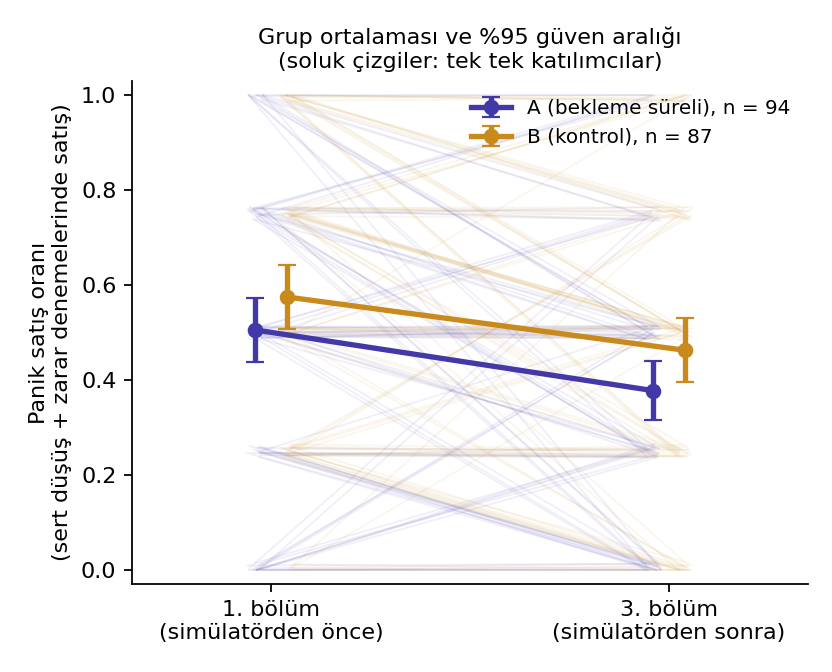
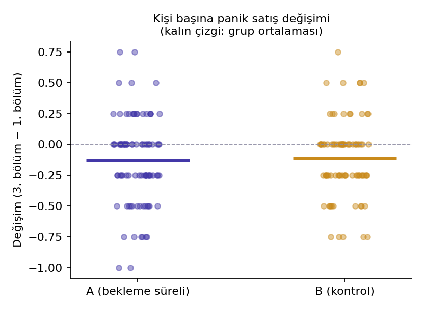

# İlk Lot – Analiz raporu

> **SAHTE VERİ: bu rapor gerçek katılımcılardan değil, ilklot_ornek_veri.py ile üretilmiş yapay veriden oluşturuldu. Sonuçlar hiçbir şey kanıtlamaz; sadece raporun nasıl göründüğünü gösterir.**

Oluşturulma: 08.10.2026 06:51 · betik sürümü 1.0 · girdi: `sahte_katilimci.csv` + `sahte_olaylar.csv` · tohum 1

## Özet

Birincil test anlamlı değil (OR = 0,92, %95 GA [0,62; 1,36], p = 0,678). Bu, etkinin olmadığını göstermez; güven aralığının dışında kalan etkiler bu veriyle olası görünmüyor.

Ham fark: A grubunda değişim -12,77 yüzde puan, B grubunda -11,21 yüzde puan; fark -1,56 yp (%95 GA [-11,07; 8,16], bootstrap).

## Uyarılar

- Grup başına tamamlayan katılımcı sayısı hedefin altında (A: 94, B: 87; hedef: 100). Sonuç güç analizinin öngördüğünden daha belirsiz olur.

## 1. Katılım akışı

| Adım | Toplam | A | B |
|---|---|---|---|
| Dosyadaki kayıt | 202 |  |  |
| Hızlı test modu (çıkarıldı) | 2 |  |  |
| Gerçek katılımcı | 200 | 100 | 100 |
| Tamamlayan (12 karar) | 181 | 94 | 87 |
| Tamamlamayan (birincil analize girmez) | 19 | 6 | 13 |
| **Birincil analiz kümesi** | 181 | 94 | 87 |

## 2. Gruplar arası denge

| Değişken | A | B | Standartlaştırılmış fark | Test |
|---|---|---|---|---|
| 1. bölüm panik satış oranı | 0,51 (0,33) | 0,57 (0,31) | SMD = -0,22 | p = 0,149 |
| Ön test puanı | 70,64 (28,51) | 63,63 (30,02) | SMD = 0,24 | p = 0,110 |
| Set sırası | X→Y: 48, Y→X: 46 | X→Y: 42, Y→X: 45 | - | p = 0,767 |
| Yaş aralığı | 18–20: 25, 21–23: 16, 24–26: 20, 27 ve üzeri: 16, Belirtmek istemiyorum: 17 | 18–20: 10, 21–23: 17, 24–26: 20, 27 ve üzeri: 18, Belirtmek istemiyorum: 22 | - | p = 0,138 |
| Cinsiyet | Belirtmek istemiyorum: 21, Diğer: 25, Erkek: 28, Kadın: 20 | Belirtmek istemiyorum: 21, Diğer: 26, Erkek: 22, Kadın: 18 | - | p = 0,902 |
| Bölüm alanı | Diğer: 20, Mühendislik ve fen: 21, Sağlık: 13, Sosyal ve beşeri: 23, İktisadi ve idari bilimler: 17 | Diğer: 16, Mühendislik ve fen: 24, Sağlık: 18, Sosyal ve beşeri: 13, İktisadi ve idari bilimler: 16 | - | p = 0,407 |
| Sınıf | 2: 23, 3: 21, 4 ve üzeri: 19, Hazırlık / 1: 12, Lisansüstü: 19 | 2: 19, 3: 15, 4 ve üzeri: 15, Hazırlık / 1: 13, Lisansüstü: 25 | - | p = 0,655 |
| Simülasyon deneyimi | Evet: 25, Hayır: 69 | Evet: 22, Hayır: 65 | - | p = 0,867 |
| Gerçek yatırım deneyimi | Evet: 45, Hayır: 49 | Evet: 36, Hayır: 51 | - | p = 0,455 |

Rastgele atamada denge testlerindeki p değerleri hipotez testi değil, tanı amaçlıdır; çok sayıda değişken test edildiği için bir-iki anlamlı sonuç şansla da beklenir. SMD > 0,5 olan ve sonuçla ilişkili görünen değişkenleri ek model olarak değerlendir.

## 3. Birincil analiz (ön kayıtlı)

**Model:** logit P(satış) = b0 + b1·A + b2·Bölüm3 + b3·(A × Bölüm3) + b4·SetY; yalnızca "sert düşüş + zarar" denemeleri (bölüm başına 4); katılımcıya göre kümelenmiş CR1 standart hata; t dağılımı (df = G − 1); α = 0,05 iki yönlü. **Beklenen yön:** b3 < 0 (OR < 1).

- Birincil analiz kümesi: A n = 94, B n = 87 (G = 181)

| Ölçüt | Tahmin | %95 GA | Test |
|---|---|---|---|
| **A × Bölüm 3 etkileşimi (odds oranı)** | 0,92 | [0,62; 1,36] | p = 0,678 |
| Ham değişim farkı A − B (yüzde puan) | -1,56 | [-11,07; 8,16] (bootstrap) | p = 0,777 (permütasyon) |
| ANCOVA: 3. bölüm ~ grup + 1. bölüm (yüzde puan) | -5,57 | [-13,88; 2,74] | p = 0,188 |
| Standartlaştırılmış etki (Hedges g, değişim puanı) | -0,05 | [-0,34; 0,24] | Welch p = 0,750 |

OR < 1: A grubunda 3. bölümde satış olasılığı 1. bölüme göre B grubundan daha çok düştü. OR popülasyon ortalamalı bir odds oranıdır (kişiye özgü değil). Permütasyon, ANCOVA ve Welch satırları aynı soruya farklı varsayımlarla bakar; birbirleriyle çelişiyorlarsa sonucu temkinli yorumla.

| Grup | n | 1. bölüm: ort. (SS) | 3. bölüm: ort. (SS) | Değişim: ort. (SS) |
|---|---|---|---|---|
| A (bekleme süreli) | 94 | 0,51 (0,33) | 0,38 (0,30) | -0,13 (0,35) |
| B (kontrol) | 87 | 0,57 (0,31) | 0,46 (0,32) | -0,11 (0,31) |

## 4. Duyarlılık analizi (dışlama kurallarına göre)

| Küme | A n | B n | OR | %95 GA | Test |
|---|---|---|---|---|---|
| Birincil: tüm tamamlayanlar | 94 | 87 | 0,92 | [0,62; 1,36] | p = 0,678 |
| Dikkat kontrolünü geçenler | 91 | 83 | 0,88 | [0,59; 1,31] | p = 0,528 |
| Anlama kontrolünde ilk denemede ≥ 2 doğru | 84 | 76 | 0,93 | [0,61; 1,41] | p = 0,722 |
| Dikkat ve anlama kontrolü birlikte | 81 | 73 | 0,88 | [0,57; 1,35] | p = 0,547 |
| Ayrıca amacı doğru tahmin edenler çıkarıldı (anahtar kelime taraması, yaklaşık) | 77 | 73 | 0,84 | [0,54; 1,29] | p = 0,416 |

## 5. İkincil ve keşifsel analizler

Bunlar ön kayıtta keşifsel olarak tanımlanmıştır; aşağıdaki p değerleri Holm yöntemiyle çoklu karşılaştırma için düzeltilmiştir.

| Analiz | Sonuç | p (ham) | p (Holm) |
|---|---|---|---|
| Doz-yanıt: A grubunda bekleme ekranı sayısı ile değişim (Spearman) | ρ = -0,29, n = 94 | 0,005 | 0,035 |
| Bekleme ekranını gören A katılımcıları ile B: değişim farkı (permütasyon) | fark = -8,88 yp, n = 61 / 87 | 0,102 | 0,508 |
| Satış gerekçelerinde "Korktum" payı (simülatör), A ve B | A: 0,55 (n=71), B: 0,51 (n=72) | 0,490 | 1,000 |
| Gerginlik değişimi (3. bölüm sonrası − 1. bölüm sonrası), A ve B | A: 0,26 (n=87), B: 0,18 (n=77) | 0,710 | 1,000 |
| Simülatör sonrası gerginlik, A ve B | A: 2,90 (n=87), B: 2,87 (n=77) | 0,671 | 1,000 |
| Karar süresi değişimi (log oran, 3. / 1. bölüm), A ve B | A: -0,00, B: 0,00 | 0,760 | 1,000 |
| Sürü bilgisi etkisi (sert düşüş + zarar denemelerinde, sürü bilgisi var / yok; deneme düzeyi, kümeye dayanıklı) | satış oranı 0,51 / 0,45, OR = 1,31 [1,08; 1,57] | 0,005 | 0,035 |

- Bekleme ekranını görmek rastgele atanmadı: yalnızca simülatörde zararına satış deneyenler gördü. Bu karşılaştırma nedensel yorum için zayıftır, birincil analiz (tüm A) esastır.

- A grubunda 33/94 katılımcı simülatörde hiç bekleme ekranı görmedi (müdahaleyi almadı). Birincil analiz niyet-tedavi mantığıyla hepsini içerir; bu oran etkinin neden küçük çıkabileceğini açıklar.

- Olay kaydı kontrolü: 2172 karar okundu; deneme düzeyi model (sürü kovaryatsız) OR = 0,92 (katılımcı özetinden birincil OR = 0,92; ikisi aynı olmalı).

## 6. Müdahale ve amaç tahmini kontrolleri

**"Simülatörde bekleme ekranı gördün mü?" cevapları (sayı):**

| Grup | Evet | Hatırlamıyorum | Hayır | Hiç satış yapmadım |
|---|---|---|---|---|
| A, bekleme ekranını gördü | 59 | 1 | 1 | 0 |
| A, bekleme ekranını görmedi | 0 | 4 | 6 | 23 |
| B (kontrol) | 3 | 26 | 48 | 10 |

**Amaç tahmini:** 116 katılımcı yazılı tahmin bıraktı; anahtar kelime taraması "bekleme/saniye/durdurma" geçen 6 yanıt buldu (yaklaşık; yanlış pozitif/negatif içerir). Doğru bir kodlama için `amac_tahmini_kodlama.csv` dosyasını gruptan habersiz iki kişiyle kodla (`manuel_dogru` = 1 ya da 0) ve `--kodlama` ile yeniden çalıştır.

## 7. Yöntem notları

- **Birincil model** kişi içi tekrarlı ölçümü katılımcı kümesine göre dayanıklı standart hatayla hesaba katar; mixed-model (rastgele kesişim) değildir. İki yaklaşımın etkisi karşılaştırılabilir ama tam aynı değildir.
- **Küçük örneklem:** G küçükken (20-30 grup başına) kümeye dayanıklı Wald testi hafif liberal olabilir; bu yüzden permütasyon ve ANCOVA satırları da raporlanır. Güç ve I. tip hata kalibrasyonu için `ilklot_guc.py` çalıştırılmalıdır.
- **Dışlamalar** veri görülmeden ön kayıtla belirlenir; bu betik sıralamayı değiştirmez. Birincil analizde dışlama yoktur (tamamlayanların hepsi).
- **Ham fark** yüzde puan cinsindendir (0,10 = 10 yp).

## Dosyalar
- `dislama_kaydi.csv`: her katılımcının neden dahil/hariç olduğu
- `amac_tahmini_kodlama.csv`: kör kodlama şablonu (grup bilgisi içermez)
- `analiz_ozeti.json`: makine okunur ana sonuçlar
